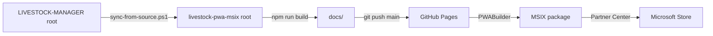

# Arquitectura PWA — livestock-pwa-msix

Versión PWA / MSIX (Microsoft Store) de Livestock Manager. Proyecto **independiente** de `LIVESTOCK-MANAGER` (Android/Google Play). No comparte historial git, no toca `capacitor.config.ts`, `android/`, ni scripts `build:*`/`cap:*` del proyecto original. Solo reutiliza como snapshot el HTML/CSS/JS raíz de esa app.

## Stack tecnológico

| Capa | Tecnología | Detalles |
|---|---|---|
| Runtime | PWA nativa | `manifest.webmanifest` + `sw.js` (Service Worker) |
| Hosting | GitHub Pages | Sirve desde carpeta `docs/` en rama `main` |
| Empaquetado | PWABuilder → MSIX | WebView2 `uap10:HostRuntimeDependency` |
| Motor | Vanilla JS + CSS | Sin bundler, sin framework, sin TypeScript |
| CSS | Design Tokens + CSS Grid | `design-tokens.css`, `styles.css`, `layout.css` |

## Flujo de build y publicación

1. **Sincronización manual** (bajo demanda): `pwsh scripts/sync-from-source.ps1` copia `css/`, `js/`, `icons/`, `manual/`, `index.html`, `sw.js` desde `..\LIVESTOCK-MANAGER`.
2. **Build local**: `npm run build` copia archivos estáticos a `docs/` (carpeta que sirve GitHub Pages). No requiere Node más que para lanzar el script PowerShell.
3. **GitHub Pages**: activar en Settings → Pages, sirviendo desde `docs/` en `main`.
4. **PWABuilder**: introducir URL pública de Pages (ej. `https://sadockdog.github.io/livestock-pwa-msix/`). Genera `.msix`.
5. **Partner Center**: subir `.msix` y completar listing.

## Diferencias clave con LIVESTOCK-MANAGER

| Aspecto | LIVESTOCK-MANAGER | livestock-pwa-msix |
|---|---|---|
| Plataforma objetivo | Android (Capacitor) + PWA | PWA / MSIX (WebView2) |
| `mode-config.js` | Build-time `prebuild:free`/`premium` | Fijo: `window.FREE_MODE = false` |
| Compra Soporte | Google Play Billing | **Desbloqueado gratis** (ver abajo) |
| `capacitor.js` | Inyectado por `cap sync` | Eliminado del `index.html` |
| Manifest icono | `Logo aplicación.png` (banner) | `Icono de aplicación.png` (1024×1024) |
| CSS heredado | `desktop.css` no existe | `css/desktop.css` **exclusivo de este repo** |

## Modelo Free / Soporte en Microsoft Store

Investigado y descartado: compras reales vía `Windows.Services.Store` (WinRT) no son viables con el modelo "hosted app" de PWABuilder (requiere `runFullTrust`, `AddHostObjectToScript` en host nativo C#/C++ — [PWABuilder #2478](https://github.com/pwa-builder/PWABuilder/issues/2478) bloqueado).

**Decisión**: `window.FREE_MODE = false` → Soporte desbloqueado gratis para todos los que instalen desde la Store. `js/purchase-manager.js` copiado pero inerte.

## Piel ERP (sidebar + tablas escritorio)

Desde PR #38 (`d436ce3`, ago 2026): sidebar `#erpSidebar` (240px) y `erp-data-table.js` migrados desde `LIVESTOCK-MANAGER` (rama `master`; absorbida desde `desktop-mvp`). Se sincronizan vía `sync-from-source.ps1`.

Archivos clave:
- `js/erp-shell.js` — inicializa sidebar, evalúa `matchMedia('(min-width: 1024px)')` en `DOMContentLoaded`
- `js/erp-data-table.js` — tablas de datos escritorio
- `css/erp-tokens.css`, `css/erp-sidebar.css`, `css/erp-data-table.css` — tokens y estilos de la piel
- `css/erp-overrides.css` — **solo este repo**, neutraliza conflictos con `css/desktop.css` (heredado, exclusivo, anterior a la piel ERP)

Bugs resueltos por choque `desktop.css` vs piel ERP (PRs #39–#42):
- `#desktopSidebar` tapaba `#erpSidebar` → `display:none !important`
- `.card-registro-quick.col-span-4` ganaba por especificidad → tarjetas apiladas
- `main#app-content { padding: 20px 48px 40px }` robaba espacio
- Convención tema invertida: `design-tokens.css` oscuro por defecto vs `desktop.css` claro por defecto

**Regla**: ante bug visual solo en esta PWA, sospechar primero de `css/desktop.css`.

## Sincronización con LIVESTOCK-MANAGER

No hay submódulos ni subtrees. Sincronización **manual y bajo demanda** via `sync-from-source.ps1`.

**Recordar en cada sync**:
- El módulo Soporte (chat IA) sigue parado en `master` hasta cerrar decisiones pendientes (add-on tiendas, precio, pago web, URL Worker). Si el sync trae `js/views/soporte-view.js` o `js/views/mis-incidencias-view.js`, son ficheros muertos que dependen de `window.SupportAPI` inexistente aquí → **descartarlos del commit** (ver `4e1da54`).
- Reaplicar ajustes propios tras sync: quitar `<script src="capacitor.js">`, mantener `mode-config.js` fijo, mantener `css/erp-overrides.css`.

## Endpoints y servicios externos

- **Soporte IA**: consume `livestock-manager-support-api` (Cloudflare Worker) en producción. Endpoints: `/tickets`, `/tickets/confirm`, `/auth/verify-purchase`, `/auth/ms/ticket-compras`. El pago web PWA aún no configurado (ver decisiones pendientes).
- **Google Play Billing**: no se usa en esta plataforma.

## Variables de entorno / Configuración

Sin variables de entorno en build. Configuración estática en:
- `js/mode-config.js` — `window.FREE_MODE = false`
- `manifest.webmanifest` — `id`, `scope`, `lang`, iconos
- `sw.js` — estrategias de caché (CacheFirst para assets, NetworkFirst para HTML)

## Reglas de desarrollo

- **Sin bundler**: editar archivos directamente en raíz, `npm run build` copia a `docs/`.
- **CSS**: añadir media queries en `layout.css` o `styles.css`; overrides específicos en `erp-overrides.css`.
- **JS**: vanilla ES modules (`type="module"` en `index.html`). No hay transpilación.
- **Testing**: validar en vivo en GitHub Pages URL tras cada push a `main`.
- **Accesibilidad**: objetivo 48×48dp touch targets, contraste WCAG AA, foco visible.